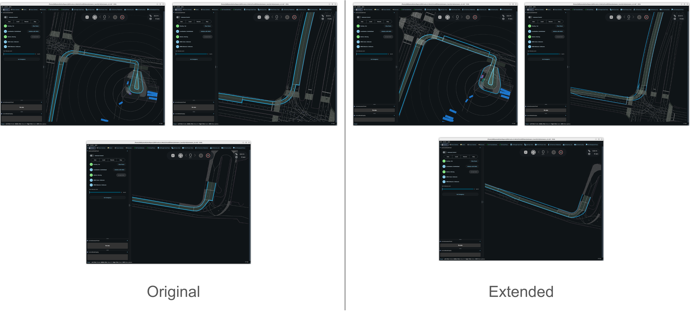

# Autoware Avoidance Target Detector

This library selects stationary vehicles eligible for lateral avoidance and moving vehicles in
nearby, disconnected lanes. It supports both `PredictedObjects` and `TrackedObjects`. MPPI uses
these selections; it does not activate object avoidance for every perceived object.

## Selection policy

Eligibility is independent of alignment with the candidate reference trajectory. A reference that
passes through a parked car must not make that car ineligible for avoidance.

For each eligible vehicle classification (car, truck, bus, trailer, motorcycle or bicycle, with
classification probability strictly above 0.1), the selector distinguishes:

| Disposition     | Meaning                                                                                                                                                     |
| --------------- | ----------------------------------------------------------------------------------------------------------------------------------------------------------- |
| `avoidance`     | Stationary, sufficiently offset from the nearest traffic-lane center, without recent moving observations, and inside the requested geometric envelope.      |
| `yield`         | Vehicle in a traffic lane, recently moving vehicle, or vehicle awaiting stationary/avoidance confirmation.                                                  |
| `driving_along` | Moving vehicle overlapping the nearby route corridor whose containing lane is not connected to ego's lane without lane changes, subject to exit hysteresis. |
| `ignored`       | Ineligible classification, no eligible track, or avoidance candidate outside the requested envelope.                                                        |
| `unknown`       | Selection cannot be determined, for example because lane context or input geometry is unavailable.                                                          |

`yield` describes policy ownership; this library does not issue a braking command. Those objects
remain the responsibility of the surrounding longitudinal planning and collision handling stack.

Parking eligibility uses the nearest road lane by **polygon distance**, then its local centerline
lateral offset. When several lanes contain the object, the smallest offset is used. This prevents
a queue in an adjacent traffic lane from appearing parked merely because it is offset from ego's
lane. Association considers up to ten nearby road lanelets and requires a centerline within 10 m.
The initial policy constants in `parameter.hpp` are:

- At least **1.5 m** from the associated traffic-lane center.
- No observation at or above **1.0 m/s** during the preceding **5 seconds** of retained history.
- A stationary Bayesian posterior above 0.5 and current speed below 1.0 m/s.

This is a parking heuristic, not a semantic parking classifier. It depends on map coverage and
lane widths; an offset queue or a centered parked vehicle can remain ambiguous. New objects have
no preceding motion evidence. The deviation posterior is retained for diagnosis but cannot veto
parking eligibility.

## Observation and time handling

Reuse one selector across callbacks and call `update_objects()` with the **full perception
message**, before spatial range filtering. This preserves motion and negative classification
evidence for tracked UUIDs.

History is updated once per distinct, increasing `objects.header.stamp`. Reusing a cached message
can rebuild geometry for a changed reference, but cannot increase Bayesian confidence, advance
hysteresis, or refresh the object's age. Age and expiry use the measurement stamp, not callback
time. The caller supplies the current time in the same clock domain as the message.

- Observations older than 1 second are stale; stamps more than 0.1 seconds ahead are rejected.
- Out-of-order observations are rejected. A backwards evaluation-clock jump clears history.
- Expired tracks are pruned before new observations, so a returning UUID starts fresh.
- A first observation initializes its state immediately. Subsequent state changes require at least
  three distinct observations and 0.5 seconds of continuous opposing evidence.
- Leaving the moving, driving-along state uses 5 seconds of continuous opposing spatial evidence.
  The deadline is not renewed while retaining the old state. Becoming stationary or losing
  classification eligibility clears that moving state immediately.

`evaluate()` and the compatibility getters are const and do not change history. Outputs only
contain objects present in the evaluated message; retaining history does not synthesize missing
objects. Replace the selector when the map or route changes, as the MPPI integration does.

## Geometry and unavailable inputs

Geometry is planar: reference altitude is removed before interpolation and nearest-segment
projection uses XY. Consecutive duplicate XY reference points are removed; at least two distinct
points and finite usable poses are required. Object footprints, velocities and orientations are
validated before selection. Object and reference frame IDs must match and be nonempty; callers
are responsible for providing them in the route map's frame.

The default avoidance geometry filters use:

- Nearest-segment projection with **unclamped terminal coordinates** for longitudinal extent.
  Footprints intersecting a returning portion of a hairpin are retained.
- Full polygon disjointness against the route corridor, including containment and edge crossings.
  Having all object vertices outside the corridor does not imply that the footprint is disjoint.
- Optional lateral and longitudinal tolerances in the standalone geometry helpers.

MPPI passes `SelectionGeometryParams::trajectory_envelope_radius_m` instead. This conservative
radius about the reference base-link path includes ego dimensions and collision-gate margins.
It replaces endpoint and route-bound pruning, keeping potential front/rear footprint collisions
and objects near a boundary. A swept circular footprint also accounts for constant longitudinal
object velocity through the reference horizon plus `prediction_extension_s`.

Reference-alignment diagnostics use rear-edge distance independent of corner ordering, samples
spaced in meters, and lateral change per meter. Their result is informational only.

`ObjectSelectionResult::status` distinguishes a ready, possibly empty selection from stale,
future or out-of-order perception, invalid reference, frame mismatch, invalid route bounds, and
invalid object geometry. Invalid nonempty route bounds are an error when corridor pruning is
requested; empty bounds explicitly disable that filter. An envelope does not require route
bounds. Invalid object geometry makes the evaluated batch unavailable and clears its output sets.
Missing lane association produces an `unknown` decision for the affected stationary object.

MPPI skips optimization with a warning when the evaluated batch is unavailable. This does not
assert that the input trajectory is collision-free and does not add a new emergency-stop policy.

## API

```cpp
using namespace autoware::avoidance_target_detector;

ExtendedRouteHandler route_handler(map_message, route_message);
route_handler.create_map();
TrackedObjectSelector selector;  // Keep this instance between callbacks.

selector.update_objects(now, tracked_objects, reference, route_handler);
const auto result = selector.evaluate(
  tracked_objects, route_handler.get_extended_route_bounds(),
  SelectionGeometryParams{ego_envelope_radius_m, extra_prediction_seconds});

if (result.status == SelectionStatus::ready) {
  // result.avoidance_targets, result.driving_along_vehicles and result.yield_targets
  // preserve input header, UUIDs, geometry and relative order.
}
```

Use `PredictedObjectSelector` with `PredictedObjects` in the same way. Evaluation may receive a
subset of the updated perception message, with its original header preserved. Compatibility
getters `get_avoidance_targets(objects, reference, bounds)` and
`get_driving_along_vehicles(objects)` read the context from the latest update; prefer `evaluate()`
when the caller needs status and rejection reasons.

Each `ObjectSelectionDecision` contains the UUID, disposition, reason, measurement age,
classification/stationary/deviation posteriors, and optional lane-center offset and distance to
the reference footprint. MPPI adds these to its existing cost/status diagnostics under
`selector/status`, selection counts, and `selector/objects/<uuid>/...`. Its decisions cover the
objects passed through its broad range/predicted-path prefilter. History still observes the full
perception message.

## Route context

`ExtendedRouteHandler` constructs a route-local map, routing graph, and original/extended route
bounds after `create_map()`. Rebuild it when the map or route changes. Its main APIs are:

| API                                           | Result                                                         |
| --------------------------------------------- | -------------------------------------------------------------- |
| `getRouteMap()` / `getRouteMapRoutingGraph()` | Route-local lanelet map and graph used by selection.           |
| `get_original_route_bounds()`                 | Left/right bounds from route-message primitives.               |
| `get_extended_route_bounds()`                 | Left/right bounds after lateral and sibling-lane expansion.    |
| `get_near_segment_polygon(start, end)`        | Extended corridor around the requested portion of the route.   |
| `get_road_borders()`                          | Nearby `road_border` linestrings.                              |
| `get_velocity_limit(point)`                   | Optional map speed limit in m/s.                               |
| `to_path_msg(bounds, trajectory)`             | Planning path message with the supplied centerline and bounds. |

`RouteBounds` is a pair of left and right lanelet 2D linestrings.



## Regression coverage

`test/test_update_objects.cpp` covers both message types: parked eligibility on a colliding
reference, traffic-lane queues, unrelated crossing lanes, endpoint envelopes, creeping motion,
corridor-spanning footprints, hairpins, altitude invariance, rear-edge reversal, sample spacing,
cached and out-of-order observations, expiry, negative classification, bounded hysteresis and
explicit invalid-input status. `test/test_boundary.cpp` covers route-context behavior.
